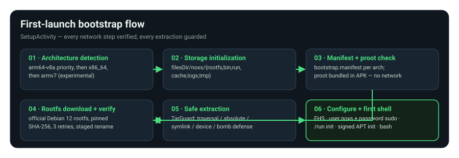

# Noxs bootstrap system



## What gets installed (current, Ubuntu-first)

| Artifact | Source | Size |
|---|---|---|
| Ubuntu 24.04 LTS (Noble) rootfs | **Official `cdimage.ubuntu.com` `ubuntu-base-24.04.5-base-arm64.tar.gz`**, staged download + SHA-256 pin | ≈ 30 MB compressed |
| proot + deps | **Bundled in the APK** as `jniLibs/<abi>/{libproot,libtalloc,libandroid-shmem}.so` | ~300 KB |

The rootfs digest is pinned in `app/src/main/assets/bootstrap/<arch>/bootstrap.manifest`
and cross-checked against the official `SHA256SUMS` at pin time
(`scripts/build-rootfs.sh`). A mismatch aborts the install — a corrupt
or tampered download is never extracted.

proot is NOT downloaded at runtime: Android 10+ (SELinux W^X) denies
`execve()` on files inside app data storage, so the binaries ship
inside the APK as `lib*.so` and the OS extracts them into
`nativeLibraryDir` — the only location where app executables may run.
`ProotLauncher` execs `<nativeLibraryDir>/libproot.so` with
`LD_LIBRARY_PATH` pointing at the same directory so `libtalloc.so` /
`libandroid-shmem.so` resolve.

## First-launch flow (installer pipeline)

```
Welcome → "Set up Linux environment"
  → architecture detection (arm64-v8a priority; also armv7 / x86_64)
  → storage check (download + extraction reserves)
  → staged download of the pinned Ubuntu rootfs (resume + retries)
  → SHA-256 verify (pinned; abort on mismatch)
  → safe extraction (TarGuard: traversal/absolute/symlink/device/bomb defense)
  → Ubuntu configuration (DNS, hosts, hostname, locale, official APT
    sources, noxs@ubuntu identity)
  → noxs user creation (+ sudo group) and password collection
    (wizard → never stored)
  → /run + /var/run/noxs init (runtime state dirs inside the rootfs)
  → signed APT bootstrap (temporary signed HTTP sources; install/verify
    ca-certificates + ubuntu-keyring; switch to verified HTTPS;
    require HTTPS apt-get update + populated lists)
  → first shell (noxs@ubuntu:~$)
```

The full stage-by-stage table lives in
[Initial setup](../getting-started/initial-setup.md); the resulting
repositories and identity in
[Ubuntu configuration](../environments/ubuntu-configuration.md).

## Package-manager safety

Only ONE apt/dpkg transaction may run at a time:

- App-side: `NoxsPkgTransaction` serializes every Noxs-managed
  operation (setup, background security bootstrap, package screen,
  Repair).
- In-shell: `apt`/`apt-get` run directly so APT/dpkg enforce their
  native locks. Noxs does not pre-block shell commands using proot
  process scans or app transaction markers, because those can be stale
  or incomplete on Android. App-launched package operations remain
  serialized by `NoxsPkgTransaction`; locks are never removed by Noxs.
- Interrupted operations: Setup console → **Repair** runs
  `dpkg --configure -a` + authenticated dependency repair + CA
  re-verification through the signed APT bootstrapper, only after the
  guard confirms nothing else is running.

## Non-blocking APT security bootstrap

The signed APT/CA/TLS bootstrap never blocks the shell:

- During setup, a failed APT step is **non-fatal by design**: setup
  still completes (rootfs + user + sudo are what a shell needs) and
  the user reaches an active prompt immediately.
- On every service start, `NoxsAptSetup` runs the same signed
  bootstrap in the background until the `apt-bootstrap-v1.ready`
  marker exists (idempotent, guarded by `PROCESS_LOCK` and a
  per-process atomic). The terminal is never gated on it.
- If the background repair fails, the terminal shows one
  informational toast and the repair is retried automatically on the
  next launch. APT metadata remains usable over signed HTTP in the
  meantime; [`nx cert-fix`](../cli/cert-fix.md) performs the same
  repair from inside the shell.

## Interruption safety

- Downloads use a `.part` staging file; the final name only appears
  after checksum verification, so power loss can never leave a
  half-verified artifact.
- Extraction is restartable: an existing complete marker
  short-circuits setup; a broken rootfs is detected by the missing
  marker and can be reset.
- Interrupted setups are detected at app start (`scanForRecovery`)
  and offered for recovery.
- Cached archives are reused across retries.

## ARM64 optimization

- Priority arch: `arm64-v8a` (manifest listed first, ABI filter in
  Gradle).
- proot static build for aarch64; `PROOT_NO_SECCOMP=1` for broad
  kernel support.
- Minimal default apt set avoids unnecessary package churn; APT
  recommends are disabled (`70noxs` conf) to cut install size.

---

## Legacy Debian bootstrap (historical, v0.x era)

The pre-Ubuntu bootstrap bundled an **offline Debian 12 (Bookworm)
ARM64 rootfs** (`rootfs.bin`) built by CI
(`scripts/build-offline-rootfs.sh` under ARM64 emulation) from the
official `debuerreotype/docker-debian-artifacts` OCI artifacts, with
preinstalled packages (`curl`, `git`, `python3`, `gcc/g++`,
`nodejs`, `sqlite3`, …), a reproducible tar/gzip pipeline and a
release-asset fallback (`noxs-debian-bookworm-arm64.tar.gz` + sha256
sidecar). The `rootfs.bin` (not `.tar.gz`) asset naming existed
because aapt2 decompresses `.gz` assets at packaging time.

This flow is **no longer used by fresh installs** — the Ubuntu-first
pipeline above replaced it. Existing Debian installs are imported
read-only as legacy environments; see
[Environment switching](../environments/environment-switching.md) and
[Backup and restore](../environments/backup-restore.md).
