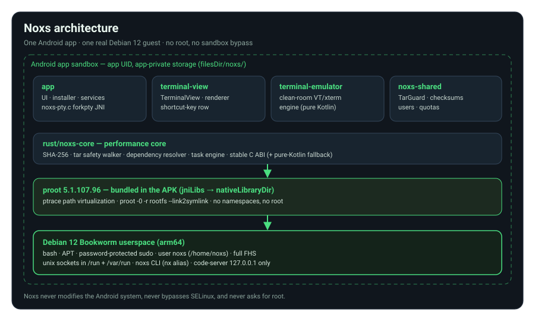

# Noxs — a small Linux computer in your pocket

<div class="hero" markdown>

**A real Linux environment for Android.** Noxs runs the genuine
**Ubuntu 24.04 LTS (Noble)** userspace — bash, APT, sudo, Unix domain
sockets under `/run` and `/var/run`, user accounts, services and the
full Linux filesystem hierarchy — inside the Android application
sandbox, using **proot**. No root required, no security bypass,
ARM64-first. *(Kali Linux support is planned — see
[environments](environments/kali-installation.md).)*

</div>

```console
noxs@ubuntu:~$ whoami
noxs
noxs@ubuntu:~$ pwd
/home/noxs
noxs@ubuntu:~$ sudo apt install git
noxs@ubuntu:~$ noxs code start
```

*(Illustrative session — not captured device output.)*

## Why Noxs

<div class="grid cards" markdown>

- :material-ubuntu:{ .lg .middle } __Real Ubuntu 24.04 userspace__

    ---

    The official Ubuntu 24.04 LTS (Noble) base rootfs with APT, glibc
    binaries and real sudo — nothing recompiled against bionic.
    SHA-256-pinned download, safe extraction.

    [:arrow-right: Ubuntu installation](environments/ubuntu-installation.md)

- :material-console:{ .lg .middle } __A real terminal__

    ---

    PTY (native `forkpty`), a clean-room VT/xterm engine, colors,
    Unicode, scrollback, resize, pinch-to-zoom, full-document search,
    multiple sessions and an honest full-screen mode.

    [:arrow-right: Terminal UX](terminal/terminal-interface.md)

- :material-folder-open:{ .lg .middle } __True FHS filesystem__

    ---

    `/bin` `/etc` `/home/noxs` `/run` `/var/run` `/var/log` — the
    layout Linux software expects. Password-protected sudo, scoped to
    the Noxs sandbox. Never Android root.

    [:arrow-right: Security model](architecture/security.md)

- :material-plug:{ .lg .middle } __Unix domain sockets__

    ---

    `unix:///var/run/noxs/…` plus Android↔Linux IPC — daemons,
    services and IPC just work, because the paths exist for real.

    [:arrow-right: Unix sockets](architecture/unix-sockets.md)

- :material-code-braces:{ .lg .middle } __VS Code in your pocket__

    ---

    The built-in editor is real code-server (VS Code in the browser),
    bound to `127.0.0.1` only, with a workspace that follows your
    active terminal session via OSC 7.

    [:arrow-right: Editor](devtools/code-server.md)

- :material-package-variant:{ .lg .middle } __NX Package System__

    ---

    `nx pkg init` scaffolds Node.js / Rust / C++ / Python / Go
    projects with automatic GitHub Actions releases, versioned
    `.nx.pkg` artifacts and sha256-verified multi-arch builds.

    [:arrow-right: Packages](packages/package-manager.md)

- :material-robot:{ .lg .middle } __AI Agent Terminal__

    ---

    `nx ai` opens an interactive `nx@ai>` agent that plans multi-tool
    work across terminal, files, packages, processes and services —
    asking `Allow? [y/N]` for sensitive actions.

    [:arrow-right: AI Agent](ai/nx-ai.md)

- :material-android:{ .lg .middle } __Android, permission-first__

    ---

    SAF storage, Photo Picker, camera, notifications, clipboard,
    share, device reports — every capability asks through Android's
    own UI, nothing at startup, everything revocable. SMS goes
    through *your own* SMS app — no SMS permission, ever.

    [:arrow-right: Android Integration](android/overview.md)

- :material-puzzle:{ .lg .middle } __API & plugins__

    ---

    The `@noxs/nx-api` SDK and Plugin SDK sit behind the Permission
    Center: packages are isolated, requests are validated and every
    grant is visible.

    [:arrow-right: Permission Center](android/app-permissions.md)

- :material-globe-model:{ .lg .middle } __Native browser__

    ---

    `nx ow https://example.com` opens a real `android.webkit.WebView`
    in a draggable floating window with URL validation, cookies and
    downloads — zero bridge exposure.

    [:arrow-right: Browser](cli/web-browser.md)

</div>



## Getting started

1. Download the latest release APK from
   [GitHub Releases](https://github.com/crossberry-in/noxs/releases)
   and install it on an ARM64 Android device (Android 7.0+) —
   [Installation](getting-started/installation.md).
2. Open Noxs and follow the automatic setup —
   [First launch](getting-started/first-launch.md).
3. Set the `noxs` user password — it is used by `sudo` inside the
   sandbox ([Initial setup](getting-started/initial-setup.md)).
4. Bootstrap downloads and verifies Ubuntu 24.04 + proot
   (SHA-256 pinned, ARM64-first).
5. The terminal opens at `noxs@ubuntu:~$` — everything after bootstrap
   works offline. Continue with
   [Quick start](getting-started/quick-start.md).

!!! info "Documentation status"
    This site documents **Noxs v1.3.x**. Features are labeled
    [available, experimental, planned or unsupported](getting-started/introduction.md#available-experimental-planned-unsupported)
    — planned features are never presented as working.

## Building from source

Requirements: JDK 17, Android SDK (platform 34), NDK 26.3, CMake
3.22.1.

```bash
scripts/bootstrap.sh          # verify toolchain, provision wrapper
./gradlew assembleDebug       # → app/build/outputs/apk/debug/app-debug.apk
./gradlew testDebugUnitTest   # JVM tests (security core, VT engine, launcher)
scripts/test.sh               # full validation incl. manifest + sync checks
```

CI builds everything automatically — see
[Testing & CI](architecture/testing.md) and
[`.github/workflows/android-ci.yml`](https://github.com/crossberry-in/noxs/blob/main/.github/workflows/android-ci.yml)
in the repository.

## About this site

Built with
[Material for MkDocs](https://squidfunk.github.io/mkdocs-material/) and
deployed automatically to GitHub Pages on every change to `main`.
Source: the
[`docs/`](https://github.com/crossberry-in/nxos-docs/tree/main/docs)
directory of the nxos-docs repository.
